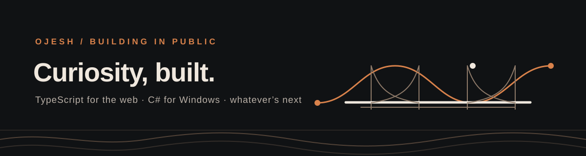

  

# Hey, I’m Ojesh 👋

I follow a “could this exist?” thought until it turns into something you can use.

**TypeScript** for the web. **C#** for Windows tools. Curiosity for the rest.

## Made from rabbit holes

- **[ClickForge](https://github.com/ojeshfrrr/ClickForge)**: A native Windows autoclicker with fixed CPS, global shortcuts, Roblox foreground checks, and timing tests.
- **[Sora](https://github.com/ojeshfrrr/Sora)**: A Windows hardware hub for the DeepCool LD360 display and Kreo keyboards.
- **[OVIO](https://github.com/ojeshfrrr/portfolio-website)**: My digital studio portfolio, with case studies and a project brief composer.
- **[Teen Fiesta Red Room](https://github.com/ojeshfrrr/teen-fiesta-red-room)**: A cinematic event page with a custom Three.js starburst.

---

**Current rabbit holes:** desktop tools, hardware controls, and web experiences with a little atmosphere. 🌱
