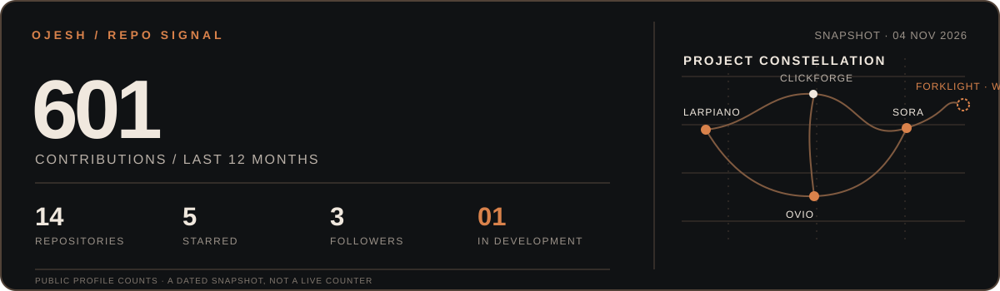

  

# Hey, I’m Ojesh 👋

I follow a “could this exist?” thought until it turns into something you can use.

**TypeScript** for the web. **C#** for Windows tools. Curiosity for the rest.

## Projects

| Project | Showcase | Area |
| --- | --- | --- |
| Larpiano | [Live app](https://larpiano.portways.app/) · [GitHub](https://github.com/ojeshfrrr/larpiano) | Windows MIDI-to-keyboard piano player |
| ClickForge | [GitHub](https://github.com/ojeshfrrr/ClickForge) | Native Windows autoclicker with fixed CPS and global shortcuts |
| Forklight 🚧 In development | [GitHub](https://github.com/ojeshfrrr/forklight) | Experimental Windows workspace for local coding agents |
| Sora | [GitHub](https://github.com/ojeshfrrr/Sora) | Windows hub for the DeepCool LD360 display and Kreo keyboards |
| OVIO | [GitHub](https://github.com/ojeshfrrr/portfolio-website) | Digital studio portfolio with case studies and a project brief composer |

  

---

**Current rabbit holes:** desktop tools, hardware controls, and web experiences with a little atmosphere. 🌱
